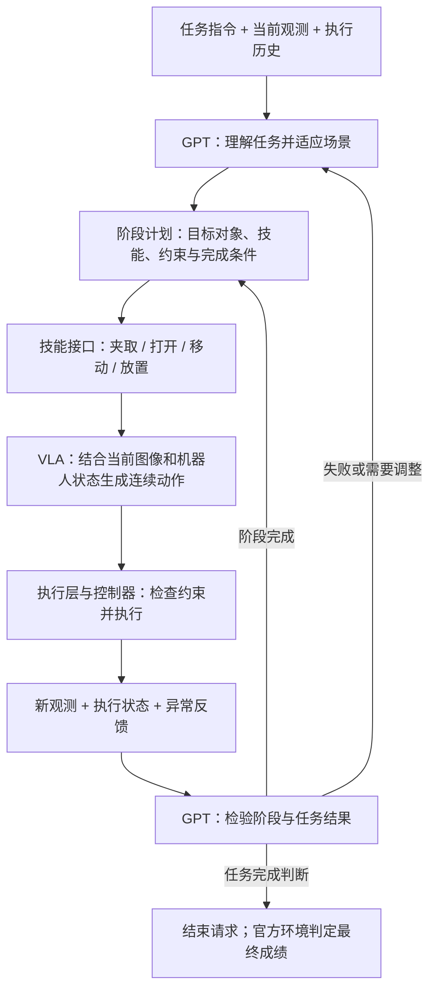

# RoboTwin / RoboCasa 冲榜路线总览

创建日期：2026-10-13

榜单规则最近核查日期：2026-10-13

状态：第 1—2 步的目标、规则梳理与方案调研已完成，主路线已确定为“GPT 阶段规划与验证 + VLA 技能执行”。下一步搭建环境并复现基线；尚未开始环境搭建、基线复现或模型训练，架构收益尚未得到运行验证。

第 1 步记录见 [榜单规则和目标](STEP1_RULES.md)，第 2 步记录见 [参考项目调研与方案候选](STEP2_SCHEMES.md)。两个榜单都做，先 RoboTwin、后 RoboCasa，优先获得可提交的完整榜单成绩。计算资源为同机 8×A100 40GB。版本兼容性、完整评测配置和外部 GPT / 混合系统收录条件保留为后续执行前的核实项。

## 一、任务目标

在 **RoboTwin 和 RoboCasa** 上构建、验证并提交一套“大脑 + 小脑”的具身任务执行系统：

- **大脑**：使用 GPT 或其他具备视觉理解和推理能力的模型，负责理解任务、适应当前场景、输出阶段计划、选择技能、检验阶段与任务结果，以及失败后的重新规划。
- **小脑**：使用 π0.5 等 VLA 动作策略，接收当前阶段的技能请求、图像与机器人状态，生成连续动作；将夹取、打开、移动、放置等实际能力封装为可调用函数，追求稳定、可靠、快速的执行。
- **接口与运行时**：负责将阶段请求交给 VLA 和机器人/仿真控制器，管理执行时长、终止、反馈与切换，并落实动作范围、速度、碰撞/异常检查和中止等安全约束。
- **评测**：按两个榜单各自的协议，在仿真中测量成功率，并与相同条件下的小脑基线比较。
- **提交**：整理代码、权重、配置、成绩及技术报告，完成榜单要求的审核与收录流程。

本项目先验证混合架构能否带来可重复的提升，再扩大训练和完整评测。是否能够获得榜首，取决于实验结果，不作为已验证结论。

### 当前选定的主架构：阶段规划、技能执行、结果检查与重新规划

GPT 输出类似专家示范标注的**阶段结构**：当前要做什么、操作哪个对象、调用什么技能、满足什么条件才进入下一阶段。VLA 根据当前场景执行该技能，将阶段目标转为连续动作。执行证据返回 GPT，供其判断继续、切换阶段或重新规划。

例如“把物体放入容器”可以形成以下阶段；这是接口设计示例，不是已实现的技能或指定榜单任务：

| 阶段 | GPT 给出的执行意图 | 可调用技能示例 | 阶段完成证据 |
| --- | --- | --- | --- |
| 抓取 | 选择当前场景中的目标物体与合适手臂 | `grasp(object, arm)` | 物体随夹爪提起并保持，而非仅夹爪已闭合 |
| 搬运 | 将已抓物体移动到容器上方，保持必要朝向 | `move(object, destination, arm)` | 物体仍被保持，并到达可放置区域 |
| 放置 | 将物体放入容器并松开 | `place(object, destination, arm)` | 物体已释放且留在目标区域 |

需要打开门、抽屉或其他容器时，可以增加 `open(target, arm)` 阶段。每个函数都要绑定真实策略能力，并明确目标、前置条件、执行预算、完成条件、可返回的证据和失败状态。物体位置或布局变化后，GPT 更新目标与阶段安排，VLA 根据实时观测重新生成动作。

**职责与验收重点：** GPT 侧重点是推理、适应、验证与重新规划；VLA 侧重点是连续动作的可靠性与速度；安全约束由运行时与控制器共同落实，并通过实际执行记录检验。可靠、安全、快速是待验证目标，不能仅凭使用 VLA 就视为已经实现。低层执行结束和 GPT 的成功判断均需与实际物理结果区分，正式榜单成绩以官方环境为准。

第一版优先选择已有能力足以覆盖的少量技能，验证同一个语言条件 VLA 能否通过不同阶段指令提供这些能力；能力不足时再决定补充数据、微调或使用独立技能策略。主路线对应第 2 步的**技能编排**候选，动作片段审核和数值接管作为后续按失败原因评估的扩展。

## 二、整体流程

**明确规则 → 调研方案 → 复现基线 → 实现最小系统 → 按需训练 → 迭代与正式评测 → 打包提交**

第 4—6 步形成循环：实验发现问题，修改大脑、接口或小脑，再重新评测。

基本原则：先跑通基线和评测，再决定训练投入；先完成本地仿真实验，最后提交上榜。最终提交对象是整套策略系统，不一定是单个模型文件。

## 三、七步推进

### 第 1 步：明确榜单规则和目标

**目的**：确定用什么数据、测什么任务，以及什么样的系统能够提交。

- [x] 确定两个榜单都做，按 RoboTwin → RoboCasa 的顺序推进。
- [x] 确定目标为可提交的完整榜单成绩，记录同机 8×A100 40GB 资源。
- [x] 梳理两个榜单的主要训练数据、任务范围、评测场景与排名指标。
- [x] 记录官方代码版本候选、发布要求和提交渠道。
- [x] 列出额外数据、外部 GPT、混合系统收录及正式评测配置的待核实事项。

**本阶段产出**：[榜单规则和目标](STEP1_RULES.md) 与官方仓库版本快照。目标与规则梳理已完成，可以进入第 2 步；本阶段完成不代表所有提交资格疑问已经获得主办方确认。

**后续执行前核实**：第 3 步固定兼容代码、资产、观测、动作预算、回合数和种子；训练投入前核实基础权重与数据边界；第 7 步提交前确认混合系统资格、模型访问和复核费用安排。清单保留在第 1 步记录中持续跟进。

### 第 2 步：调研三个参考项目并形成方案候选

**目的**：找出可复用的闭环、接口和调度逻辑。

- [x] 调研 **GPT-Policy**：观测与示范上下文组织、结构化工具请求、执行反馈。
- [x] 调研 **GPT-as-Policy**：π0.5 动作提议、GPT 审核、动作片段执行与局部纠错。
- [x] 调研 **PhyAgentOS**：技能封装、认知与物理执行分离、结果验证和运行时。
- [x] 比较三种路线：技能编排、动作监督纠错、两者结合。
- [x] 记录公开代码范围、依赖、模型访问要求和迁移到两个榜单的工作量。
- [x] 根据任务特点、可复现性与计算预算，选出第一轮实验建议。

**产出 / 完成条件**：技术方案草案、可复用模块清单和待实现模块清单。调研不要求把三个项目全部完整复现。

**本阶段产出**：[参考项目调研与方案候选](STEP2_SCHEMES.md)。当前已选择 GPT 阶段规划、结果检查与重新规划，以及 VLA 技能执行的主路线；从少量经过验证的技能建立最小闭环。已完成静态调研，未验证运行兼容性和架构收益。

### 第 3 步：搭建仿真环境并复现基线

**目的**：建立可信的评测底座和比较对象。

- [ ] 安装两个环境，下载所需资产、数据和可用基线权重。
- [ ] 为两个环境分别接通观测和动作接口，检查相机、状态、动作维度及归一化。
- [ ] 跑通“读取观测 → 策略预测 → 仿真执行 → 环境判定结果”的完整流程。
- [ ] 使用 π0.5 或其他可复现策略建立小脑基线；没有适配权重时，先完成必要的基线微调。
- [ ] 在开发任务中检查 VLA 对夹取、打开、移动、放置等候选技能的实际支持，记录适用对象、前置条件、完成证据和失败情况。
- [ ] 保存配置、版本、随机种子、逐任务结果和视频，排查接口或环境错误。

**产出 / 完成条件**：两个榜单都能重复运行评测，并获得可追溯的基线成绩。初期可先做少量任务验证，完整基线与最终比较协议保持一致。

### 第 4 步：实现最小的大脑小脑系统

**目的**：先验证架构价值，再扩大投入。

- [ ] 选一个环境和少量代表任务，覆盖简单动作、多阶段任务及容易失败的情况。
- [ ] 接入高层模型，定义其可使用的观测、历史和工具。
- [ ] 定义 GPT 的阶段输出：阶段目标、对象/目的地、技能名称与参数、前置约束和完成条件。
- [ ] 将已验证的少量 VLA 能力封装成技能函数，接通“阶段请求 → 语言条件/策略输入 → 连续动作 → 控制器执行”。
- [ ] 定义接口参数、执行时长、终止条件、超时、失败反馈和中止机制，并实现运行时安全检查。
- [ ] 将阶段执行证据返回 GPT，实现阶段完成检查、任务结果检查、失败诊断和重新规划；证据不足时继续观察或执行，保留不确定状态。
- [ ] 与相同条件下的小脑基线比较，保存成功和失败案例。

**产出 / 完成条件**：一套能通过阶段规划与技能调用完成完整任务、并在失败后尝试恢复的原型；同时获得大脑是否改善成功率、小脑技能是否足够可靠和快速、运行时约束是否有效的初步证据。

注意：给 π0.5 套上 `pick(object)` 或 `open_drawer()` 这样的函数名，不会自动获得可靠技能。接口需要对应实际策略能力，并明确何时完成、失败时返回什么。

### 第 5 步：根据失败原因训练或微调

**目的**：让训练投入对应真实的能力缺口。

- [ ] 分析失败来自感知、任务分解、目标选择、连续动作、阶段切换还是完成检测。
- [ ] 小脑不会执行目标动作时，使用协议允许的数据微调，并适配机器人动作空间。
- [ ] 小脑会做动作但目标或顺序错误时，优先改进大脑上下文、提示词和接口。
- [ ] 技能编排需要子任务数据时，准备允许使用的子任务标注和训练样本。
- [ ] 根据技能执行与阶段切换失败，补充必要的恢复示范、完成检测或技能终止能力；训练与接口改进分别记录贡献。
- [ ] 固定训练与开发评测划分，记录数据来源、基础权重、训练配置和 checkpoint。
- [ ] 为两个环境分别准备适配策略；不预设同一份权重可以直接通用。

**产出 / 完成条件**：适配环境的小脑权重、确定的大脑配置，以及训练和数据使用记录。

通常先微调小脑，不需要从头训练 GPT。高层模型可以先固定参数，通过上下文、工具接口和执行反馈实现指挥；已有权重足够时，也可以先不训练。

### 第 6 步：迭代并完成正式评测

**目的**：证明提升来自本项目的贡献，并获得完整、可复核的成绩。

- [ ] 在相同任务、初始条件和明确的预算设置下比较基线与混合系统。
- [ ] 优先比较 VLA 基线、GPT 阶段规划，以及增加结果检查/重新规划后的系统，定位各模块收益；需要时再增加动作监督纠错对照。
- [ ] 如使用关键帧、示范或人工阶段标注，固定来源与制作流程，核实推理使用口径，提供有/无参考上下文对照。
- [ ] 记录逐任务成功率、技能成功率、阶段切换与恢复情况、视频、失败原因、实际耗时、模型调用次数和成本。
- [ ] 记录碰撞、越界、异常中止与安全干预，并分别统计 VLA 执行时间和 GPT 等待时间，检验可靠、安全、快速的目标。
- [ ] 使用开发评测迭代方案，避免把最终评测结果反复用于调参。
- [ ] 冻结最终权重、提示词、接口、代码版本和配置。
- [ ] 按完整官方协议运行最终基线与候选系统，报告分组成绩及结果波动。

**产出 / 完成条件**：完整评测报告与可复现材料，能够说明贡献、提升幅度及适用范围。任务成功由榜单环境的判定逻辑决定。

### 第 7 步：打包并提交上榜

**目的**：让主办方能够运行、复核并收录结果。

- [ ] 整理代码、权重或访问方式、依赖、模型配置和评测入口。
- [ ] 发布复现说明和技术报告，说明基础模型、冻结部分、训练部分及数据使用。
- [ ] 提供正式成绩、逐任务结果和必要的视频、日志。
- [ ] 按 RoboTwin 的收录要求提交材料。
- [ ] 按 RoboCasa 的模板提交成绩文件 PR 和复现材料。
- [ ] 配合主办方复核，处理复现差异，并确认最终收录。

**产出 / 完成条件**：完成两个榜单要求的提交与审核流程，结果正式收录。

## 四、两个榜单的关键区别

以下是 2026-10-12 核查到的公开规则摘要。正式实施与提交前，应重新确认规则及适用赛道。

| 项目 | RoboTwin 2.0 | RoboCasa365 当前多任务榜单 |
| --- | --- | --- |
| 评测范围 | 50 个双臂任务，分别评测干净场景和随机化场景 | 50 个目标任务，分为 Atomic-Seen、Composite-Seen、Composite-Unseen，并非全部 365 个任务 |
| 数据协议 | 榜单规定 50 个任务，每任务 50 条 `demo_clean` 示范，共 2,500 条 | 榜单说明使用 Human300 预训练数据，未见组合任务评测零样本泛化 |
| 成绩 | 分别报告 clean2clean、clean2random 及其平均值 | 报告三个任务分组的成功率和总体成绩 |
| 提交 | 公开代码、权重和技术报告，向维护者申请收录 | 向榜单仓库提交成绩 JSON 的 PR，提供复现材料，团队核验后收录 |
| 方案约束 | 混合系统及外部模型访问的具体收录要求需核实 | 要求明确的方法或数据创新及可测量的提升；短暂微调或小改动不自动构成新条目 |

**数据网站提供了某类示范，不等于该榜单协议允许使用它训练。** 特别是 RoboCasa 的目标任务数据与当前零样本评测设置，需要区分清楚。

## 五、首个里程碑与推进建议

**首个里程碑：两个仿真环境都能运行基线；在先行的 RoboTwin 少量代表任务上，跑通“GPT 阶段规划 → VLA 技能执行 → 结果检查 → 重新规划”，验证能否带来可重复的提升。**

完成后，再决定是否扩大技能范围和训练、增加动作监督纠错，并迁移到 RoboCasa。高层阶段规划、技能调用与结果反馈协议尽量复用；仿真适配、动作空间、小脑训练及技能完成检测分别处理。

## 六、参考入口

### 榜单与规则

- [RoboTwin 官方榜单与评测、收录要求](https://robotwin-platform.github.io/leaderboard)
- [RoboTwin 官方代码](https://github.com/RoboTwin-Platform/RoboTwin)
- [RoboCasa 官方榜单与评测协议](https://robocasa.ai/leaderboard.html)
- [RoboCasa 榜单提交仓库](https://github.com/robocasa-benchmark/leaderboard)
- [RoboCasa 数据集说明](https://robocasa.ai/docs/build/html/datasets/datasets_overview.html)

### 优先调研项目

- [GPT-Policy](https://github.com/cheng-haha/GPT-Policy)
- [GPT-as-Policy](https://github.com/anonymous-report-421/GPT-as-Policy)
- [银河通用 GPT-as-Policy 相关论文](https://arxiv.org/abs/2609.38537)
- [PhyAgentOS](https://github.com/PhyAgentOS/PhyAgentOS-core)

### 执行层与架构参考

- [openpi：π0.5 代码、权重及微调示例](https://github.com/Physical-Intelligence/openpi)
- [XPolicyLab：策略适配与评测接口](https://github.com/XPolicyLab/XPolicyLab)
- [Hi Robot：层级视觉语言动作模型](https://arxiv.org/abs/2502.19417)
- [Code as Policies：通过程序组合机器人 API](https://code-as-policies.github.io/)
- [SayCan：语言规划与可执行技能结合](https://github.com/google-research/google-research/tree/master/saycan)
