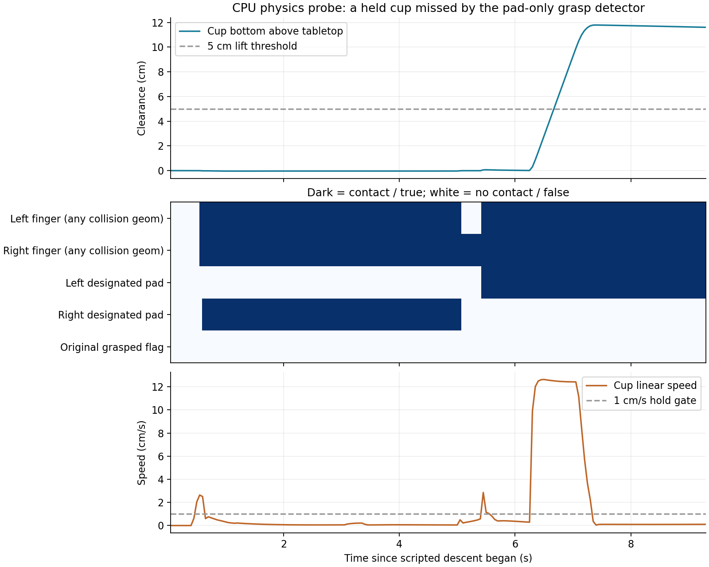

# 抓取漏判仿真实验与critic问题补充

2026-11-06，北京时间。本报告是本目录原诊断的补充，不改写原训练、奖励或checkpoint。

## 结论

**已在相同白杯、相同场景、相同seed和原始物理参数下，用CPU仿真复现“实际双侧持物并抬升，但pad-only抓持判据始终为假”。**接触来自左侧手指主体/指垫和右侧手指主体；右侧指定指垫没有接触。这是抓持判据覆盖不足的直接实例。

对同一条物理轨迹，仅在离线奖励重算中把抓持判据从“双侧指定指垫接触”替换成“双侧手指接触”，原始ledger回报由 **−0.100125变为+1.396829**，且后者满足原有抬升、低速度和2秒保持条件，返回success。没有加载actor或critic，因此此类漏奖独立于critic存在。

这不能排除critic也存在问题，也不能证明原始39步视频的具体接触对完全相同。原视频没有保存动作、EEF姿态或接触对；按记录的EEF位置、固定姿态做的近似回放，反而通过了pad判据。因此本次确认的是**可复现的同类漏判机制**，不是逐动作还原原视频。

## 原视频事实

文件：`reports/rl_skills_v3_20261104/overnight/videos/eval-final-actor0-pick.mp4`，case `pick-00`、seed `90000000`、白杯 `porcelain_mug_1`、原场景task6。

原trace共39步，每步grasped均false。第35步参考抬升6.96cm、累计奖励−0.2115；第39步抬升约10cm、物体XY偏移5.04cm并越界结束，总回报−1.361796。完整分解：height=0、hold=0、XY累计路程=−0.357896、时间=−0.0039、终止失败=−1。没有下降惩罚。

原trace来源：`/data/wangyihan/getscore-rl-skills/runs/pi05-skills-v3-overnight-20261104-to-20261105-0900/eval-environments-final-actor0/env00/episode011897/native-trace.jsonl`。

## 实验方法

- 使用run归档源码`source/v3_skill_env.py`、同一effective-config、原始白杯资产与机器人控制器。
- 每个探针重建原seed的初态。所有探针的物体初始位置与原视频reset记录最大误差为0。
- 关闭相机和渲染，只运行CPU MuJoCo与原OSC控制器；不加载策略或价值网络，不创建GPU渲染上下文，不修改质量、摩擦、碰撞或控制频率。
- 使用脚本动作完成下降、闭合、抬升约12cm、保持闭合40个原生步（2秒）。这验证物理接触与奖励判定，不代表RL策略已学会动作。
- 除近似EEF路径探针外，垂直下降目标相对白杯参考位置的偏移为表中值；不旋转EEF。记录每个20Hz步的接触几何、接触法向力、杯底真实间隙、速度、夹爪开度和原抓持判定。
- 为完整观察接触，脚本探针直接执行物理step，不在原技能首次失败时切断；随后单独用原RewardLedger离线重算，按其terminal/truncation停止。原训练规则未变。

服务器输出：`/data/wangyihan/getscore-rl-skills/records/grasp-contact-diagnosis-20261106-113318`。

## 结果

|探针|最终杯底离桌|离桌≥5cm的步数|这些步中原抓持判据为假|双侧任意手指接触|双侧指定指垫接触|
|---|---:|---:|---:|---:|---:|
|近似记录EEF路径，固定姿态|8.58cm|44|0|44|44|
|X偏移+1.2cm，Z目标5.2cm|12.13cm|54|0|54|54|
|X偏移0，Z目标3.5cm|11.61cm|53|53|53|0|
|X偏移0，Z目标5.2cm|11.61cm|53|53|53|0|
|X偏移0，Z目标7.0cm|11.69cm|53|53|53|0|

相同seed、固定脚本的高度探针不是独立随机样本，3.5cm和5.2cm结果相同，不应把它们当作独立成功率统计。

在代表性漏判探针`wall_dx0_z52`的最后20步：杯底间隙保持11.605–11.704cm，线速度最高约0.106cm/s，双侧手指接触20/20步、双侧指定指垫接触0/20步。它不是物体短暂被碰飞的表现。

典型接触几何：

- `gripper0_right_finger1_collision`：左侧手指主体；
- `gripper0_right_finger1_pad_collision`：左侧指定指垫；
- `gripper0_right_finger2_collision`：右侧手指主体；
- 没有 `gripper0_right_finger2_pad_collision` 接触。

接触记录包含非零法向力。`_check_grasp`只检查左右`fingerpad`组，不检查完整`left_finger/right_finger`组，因而漏掉上述双侧接触。

## 对“杯壁不竖直”的判断

用户关于“实际夹住，但指定指垫未同时接触”的机制得到实验支持。**尚不能把根因精确归结为杯壁倾斜。**当前实验没有单独改变杯壁斜率、杯柄或碰撞网格，因此杯口/杯壁/杯柄几何、抓持高度、EEF朝向及碰撞几何细分的贡献尚未隔离。

同样白杯仅改变1.2cm抓取偏移即可从漏判变为pad判据通过，说明接触位置很关键；这不是接触力“太小未达阈值”，因为当前`_check_grasp`本身没有接触面积或接触力阈值，只检查指定几何组是否存在接触。

## 离线奖励重算

代表性探针`wall_dx0_z52`：

|同一物理轨迹的评分方式|高度进度|保持进度|回报|结果|
|---|---:|---:|---:|---|
|原双侧指定指垫判据|0|0|−0.100125|186步内未触发成功|
|离线假设：双侧完整手指接触|1|1|+1.396829|第186步成功|

其他奖励参数完全相同；未把替代判据部署到训练。两种回报并非只差固定1.5，因为改判抓住后也会激活原有下降惩罚等条件。

“双侧完整手指接触”只是用来定位问题的替代判据，不应直接作为已验证的通用方案。生产判据还应检查目标物体、双侧几何接触、离桌、持续共运动/相对姿态稳定、低速保持等，避免把挤压、抵住桌面、短暂勾碰算为稳定抓取。杯壁和杯柄抓法都应覆盖，不能把只允许指定pad接触当成任务要求。

## critic是否可能失效

可能存在价值估计问题，但需分开判断：

1. 视频`reward/total`来自RewardLedger，不调用critic；本次不加载critic也能复现漏奖，因此不能用critic失效解释该打分机制。
2. critic学习的是当前奖励规则定义的未来回报。如果规则把成功持物错误记成无抓持，即使critic把这些回报预测得很准，也可能指导策略远离用户想要的动作。
3. 现有550轮日志里critic loss前50轮均值0.07657、后50轮0.05551，说明拟合损失下降；checkpoint中critic参数有变化。两者均不足以证明价值估计有效。
4. 已有代码风险仍存在：200步任务期限bootstrap语义与用户目标不一致；critic未显式输入剩余时间、保持计数和奖励账本等历史状态；VLM特征冻结。
5. 日志没有保存每状态的value/return对、价值解释度或按阶段误差，不能从现有聚合指标补算出这些证据。需要先修正评分与任务语义，再在固定成功/失败轨迹上记录V、后续实际回报、误差和explained variance，并在相同阶段/剩余时长内比较预测。V本身不是“当前动作完成得多好”的评分，也不要求它随抬升高度单调上升。

因此优先顺序是：修正并验证抓持评分覆盖，明确终止目标，再验证critic是否正确预测这些目标下的回报；不是先换critic来补偿打分漏判。

## 产物与限制

- [实验脚本](grasp_contact_probe.py)
- [探针汇总](grasp-contact-summary.json)
- [接触逐步数据](grasp-contact-traces/)
- [离线替代判据奖励重算](grasp-contact-counterfactual.json)
- [绘图脚本](plot_grasp_contacts.py)

初次启动缺少服务器专用EGL动态库搜索路径，在创建实验环境前退出；第二次使用原项目现有system-libs路径完成。未安装依赖、未改系统设置、未终止其他进程。实验未使用GPU推理或训练。没有对原始视频做精确动作重放，没有评估新判据的泛化误判率，也没有声称已定位全部训练失败原因。
