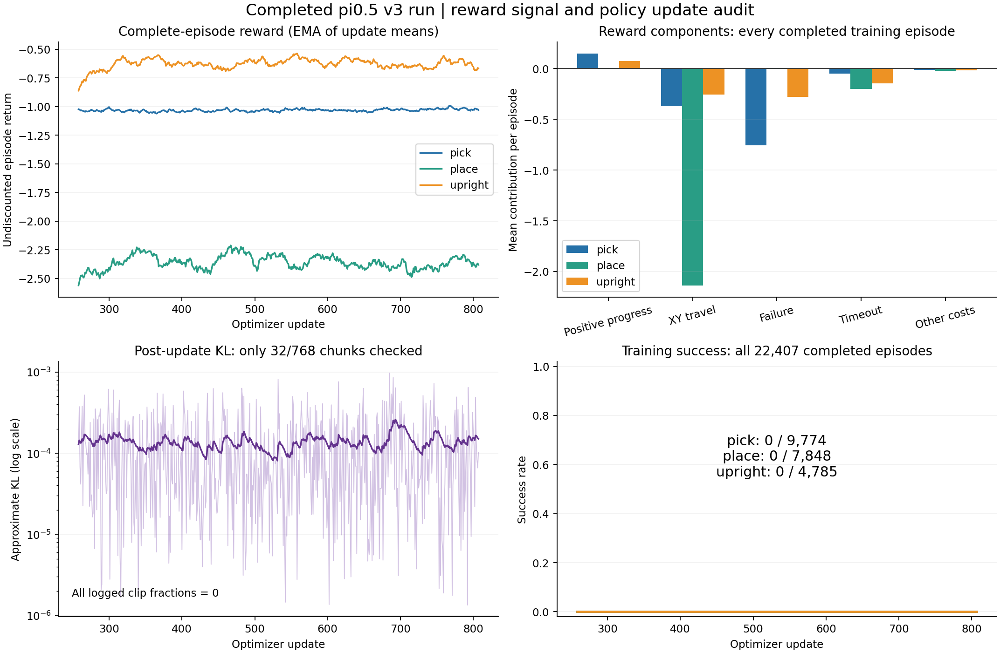

# π0.5 三技能失败调查：代码、奖励分解与参数

日期：2026-11-06，北京时间。调查仅只读访问服务器，未改训练代码、配置、模型或进程，未启动训练。以下事实以最近 v3 夜间续训为主；第一次 v2 的规则不直接套用到 v3。

运行目录：`/data/wangyihan/getscore-rl-skills/runs/pi05-skills-v3-overnight-20261104-to-20261105-0900`。检查了归档运行源码、550轮更新日志、22,407条自然结束训练episode、baseline/final共138条有效评测的原生步trace，以及update257与807的checkpoint。16份归档Python源码与原始manifest的SHA-256逐一相同，见[source-verification.json](source-verification.json)。额外的`rlinf_*`和tokenizer源码是调查时服务器依赖快照，不冒充该run归档manifest覆盖的源码。

## 主要结论

当前证据支持：旧场景动作先验持续存在，正确技能后段极少被探索到，奖励的正向反馈触发稀少，策略更新保守。证据不支持“因为奖励为负所以RL不能学习”或“LIBERO权重已经不可能改变”。尚未通过受控实验量化每个因素的因果贡献。

此外，有一个与用户明确意图不一致的时间语义：用户要在10秒内完成局部技能，代码却把200步截止当成可以继续的truncation并bootstrap。critic也没有剩余时间、保持计数、奖励已获额度等输入。需明确任务定义后修正；采样批次边界的bootstrap与任务截止的处理不能混为一谈。

## 1. LIBERO模型与pi05_base

π0.5 base是官方可用于微调的预训练模型，LIBERO版本是其任务微调模型；官方`pi05_libero`训练配置本身从`pi05_base/params`初始化。因此可以使用base训练，不能据此保证它更容易在LIBERO机器人上探索成功。[官方模型列表](https://github.com/Physical-Intelligence/openpi#model-checkpoints)、[官方训练配置](https://github.com/Physical-Intelligence/openpi/blob/main/src/openpi/training/config.py)

本项目冻结VLM，只训练action expert的rank16 LoRA和critic。场景偏置未消除，有可能来自既有表征、采样分布、正向反馈和更新强度的共同作用。`flow_sde=.5`实际有随机探索：当前RLinf每个训练chunk在10个去噪步里随机选择一个步注入SDE噪声，其他步为ODE。不能把`.5`解读成机械臂50%的随机动作，也不能把训练不成功解释为完全没有探索。

已确认的切换障碍：`runtime.py:33`硬编码加载`pi05_libero_torch/model.safetensors`，`:42`硬编码读取LIBERO归一化统计，模型和transform也写死`discrete_state_input=False`。只修改JSON中的`base_checkpoint`不能切换实际权重。[归档模型加载](source/runtime.py#L31)

切换base应建立单独配置、记录实际加载路径/hash，匹配相机、状态格式、动作语义和归一化。官方Pi05默认离散state输入开启，LIBERO特定配置关闭；base的输入约定不能直接假定与LIBERO相同。[官方Pi05配置](https://github.com/Physical-Intelligence/openpi/blob/main/src/openpi/models/pi0_config.py)

推荐保留LIBERO作对照，先做同一单杯场景下的短评测：接近、夹持、抬起的探索覆盖和动作多样性。base若缺少当前机器人动作先验，先用已验证的成功示范做小规模SFT/BC适配，再比较RL；示范失败不能记成成功。无需在本次调查中下载或启动base。

## 2. 抓取奖励是否惩罚下降去抓

这条需纠正：v3惩罚的是物体的下降，且必须该episode已获得过height奖励，才开始累计下降；夹爪下降接近未抬起的杯子不受这项惩罚。训练中该项平均仅为`-0.001027`，不是主要负奖来源。[归档奖励](source/v3_reward.py#L31)

用户提出增加接近和物体离桌高度反馈，方向合理。v3抓取分支没有接近奖励，也没有首次真实抓持奖励，只有达到5cm后才获得height进展。这会让接近、闭合夹爪、最初几厘米提升缺少正向引导。CPU直接执行归档ledger已验证：仅夹爪接近只有`-0.0001`时间成本；首次有效5cm高度奖励为`.06`；已有抬升后下降1cm才有下降扣分。见[复核记录](reward-replay-check.json)。

不建议直接逐帧累计`接近分数 + 离桌高度`：可能奖励贴着杯子不动、悬停或反复抬落。建议分阶段：接近有效抓持位置的进展 → 一次真实抓持 → 有效夹持下的有界离桌提升 → 减速并保持。距离需考虑夹爪接触几何、双指与可抓区域，单个最近点接触不等于抓住。真实离桌高度可复用已有`collision_bottom()-support_z`；当前pick的`lift_m`实质是物体body参考高度相对初始高度变化，对旋转后的物体不等于精确碰撞底部间隙。

可采用有界的阶段进度记账，或严格按`gamma*Phi(next)-Phi(current)`构造潜势差，并正确处理终态。两者都要验证正确轨迹优于不动、推倒、搬走、循环抬落。[奖励塑形原始论文](https://people.eecs.berkeley.edu/~pabbeel/cs287-fa09/readings/NgHaradaRussell-shaping-ICML1999.pdf)

## 3. 越界立即结束还是持续扣分

终止惩罚会通过return/GAE反馈到越界前的动作，不需要继续执行才能学习它不好。若原地5cm是绝对不可违反的任务条件，立即失败合理。

若初期希望模型学会“偏了一点后纠正回来”，建议软边界与较远的硬边界分开：局部偏移/累计路程有成本，软边界外允许回正，严重越界或掉桌才终止。若用户仍要求超过5cm永久失败，则不能同时把回正轨迹计为成功；这涉及任务定义改变。

持续越界惩罚应按偏移程度和持续时间计费，不能只保留当前的XY路程成本：物体停在越界处后，路程成本会变成0。也不应无限加大惩罚；所有行为都很负时可能鼓励不动，或在其他设置中鼓励提前失败逃避后续成本。

数据上，抓取9,774次尝试有7,380次因XY>=5cm终止，占75.51%。只有15条曾获得任何保持进度。最终固定评测里12/24曾夹持抬升>=5cm，但这些时刻物体线速度从未低于1cm/s，连1步hold都没记到；20/24以水平越界结束。瓶颈更具体地指向“抬后继续运动、缺少减速保持”。

## 4. 为什么回报为负，量级是否失衡

以下是全部训练episode的平均分解，非最后一帧reward；由最终ledger状态重建，并逐条与完整episode总回报核对（误差<1e-5）。

|平均每episode|抓取（9774条）|放置（7848条）|扶正（4785条）|
|---|---:|---:|---:|
|正向进展/事件合计|+0.150|+0.00468|+0.0746|
|物体XY累计路程|-0.368|-2.137|-0.255|
|失败|-0.755|-0.000637|-0.280|
|超时|-0.0489|-0.1999|-0.144|
|时间与下降成本|-0.0108|-0.0200|-0.0172|
|总回报|-1.034|-2.353|-0.621|

负数本身不是错误：PPO用相对优势，好行为可以是“更少负”。但这里正向阶段信号实际接近缺席，尤其放置：仅233/7848（2.97%）得到下降进展，21条有contact事件，1条有条件release事件，0条retreat事件，0条完整成功。

当前水平成本为每米5分，5cm物体累计移动就扣`.25`，而抓取首次达到5cm只奖`.06`，完整高度预算`.3`。高度、接触、保持预算相对实际探索中的成本偏弱；但不能只根据失败样本的正负比机械调整，仍需验证完整正确轨迹的回报排序及分阶段信号。理想无水平移动的成功pick仍可获得约`+1.48`，并非代码让所有成功都必然为负。

建议先为接近、抓持、减速保持提供可触达的进度；核验路径成本是否按预期惩罚物体而不是必要夹爪运动；再按好坏轨迹排序调相对权重。不要为把曲线变正而每帧加常数，变长/变短episode可能因此改变偏好。统一放大所有reward也不能修复排序和触发缺失，并可能改变critic及梯度裁剪行为。

## 5. 放好之后去拿巧克力、短时限与批次截断

代码确实加载原版多任务场景，保留其他物体；但传入模型的是技能prompt，原场景reward/done被丢弃，自定义ledger判定成功。因而看到后续旧动作，符合场景诱发既有动作序列的假设，但代码没有给“拿巧克力”奖励。[场景与prompt](source/v3_skill_env.py#L29)、[环境step](source/v3_skill_env.py#L160)

本次最终21个有效place评测原生trace中，0条获得下降进展，0条曾在规定局部目标区域获得真实支撑接触。代码不会把搬去原盘子/盒子的放置判为新局部技能成功。因此这些案例不是“已经符合新任务成功条件，却继续运行到超时”。若要核对用户指出的视频是否为另一轮/另一案例，需对应视频的run与case，不能把该观察泛化为已被本轮固定评测证实。

短任务上限与采样边界是两回事：

- 10秒为任务本身上限，用来规定何时必须完成。
- 一批采样结束只是训练器准备更新参数；若episode未到上限，应继续该环境。
- 成功条件满足应立即结束，避免后续无关动作。单纯缩短时间不会教会“完成后停下”，可能只让下一物体的动作尚未在视频中出现。

当前place包含4秒连续稳定，因此200步里只剩最多6秒用于下降、释放和撤离。需要用成功控制轨迹验证是否足够，不应未经验证继续缩短。

更重要的代码问题：`v3_reward.py:64`将200步截止写为truncated；`v3_train.py:102`对其计算bootstrap；`:37`只有terminated才屏蔽下一状态价值。用户明确要求10秒内完成任务时，应把期限建模为有限时域终止，期限之后价值为0；同时让critic至少知道剩余时间。若将其定义为仅采集限制，则保留bootstrap合理，但那与当前用户目标不同。[Gymnasium时间限制说明](https://gymnasium.farama.org/tutorials/gymnasium_basics/handling_time_limits/)

另一个设计细节：放置稳定阶段每帧都要求夹爪张开>.06；如果目标已释放撤离后夹爪去抓别的物体，稳定计时会被清零。可将“已释放撤离”锁存为事件，之后单独检查目标物体稳定；如由外部技能执行器在该阶段停发动作，要明确这是控制器停止，不冒充策略自主学会停止。这不是本轮21个固定place失败的已证实首因，因为它们连局部支撑阶段都没进入。

## 6. 空桌面、单个白杯

赞同作为最小诊断场景，先只做pick；使用相同机器人、控制器、桌面碰撞与白杯资产，移除其他可操作对象和旧任务目标。略微随机化杯子位置/yaw及初始夹爪状态，固定独立评测种子，避免学成一条死轨迹。然后再分别引入held-state place和倾倒upright，最后增加干扰物与背景。

这样能降低旧场景线索和任务复杂度，不能“清除权重记忆”；新的空桌画面也可能造成视觉分布变化。最有解释力的最小对照是在相同简化环境、预算和新奖励下比较LIBERO与经过输入/动作适配的base，不能同时换模型、场景、奖励、学习率后只凭成功与否归因。

## 7. 参数及曲线实查

|参数/指标|实际值|解释及建议|
|---|---|---|
|actor LR|1e-6|保守但不是异常值；修复反馈和时间语义后可短程对照1e-6、3e-6、5e-6，不承诺其中哪个最优|
|critic LR|1e-5|RLinf标准示例1e-4，但小任务、LoRA、reward尺度和batch不同，不能直接照搬；先补explained variance与value/return统计|
|更新频率|768 chunks/全局优化器步，每chunk最多8原生步|每约6090原生步只做一次中央AdamW更新，实际少于6144因块内终止；不是6144次优化|
|update_epochs|配置1，代码固定单次更新|所有microbatch梯度先累加再opt.step；clip在ratio=1处不约束首个梯度，是有效的on-policy首步，不等于多轮PPO；只改该配置不会增加循环|
|post-update KL|中位7.23e-5，最大9.71e-4|策略单步变化小，但只抽32/768 chunks（4.17%），并非全量KL或全部动作分布|
|clip_fraction|550轮均0|未达到20%概率比裁剪；本身不证明学习率错误|
|actor_loss|约1e-9|全局优势标准化且优化前ratio≈1，均值接近0是预期代数结果，不是零梯度证据|
|梯度clip阈值|1.0|334/550轮合并actor+critic范数超过1，中位裁剪倍率约0.799；不是数值爆炸证据，需分开报告两组梯度|
|gamma|每原生步.998，8步.9841，200步.6701|当前10秒范围内不过分短视；与GAE一起在后段反馈稀疏时会削弱远端信用，但不宜先作为主因|
|GAE lambda|每chunk.95|常见起点；一个chunk约.4秒，不能和逐原生步lambda直接等同比较|
|LoRA|rank16/alpha16，仅action expert|规模可作为合理起点；VLM冻结不是bug，也不能假定足以修复语言—动作绑定|
|执行块|8步/.4秒|精细抓稳/接触可对照4或5步，但须正确处理模型horizon10、执行mask和数值重算，不能直接降低采样batch8|
|flow SDE|noise=.5，joint_logprob=false，entropy=0|符合官方Flow-SDE建议；不能仅凭entropy=0断言没有探索|

RLinf标准π0.5 LIBERO PPO示例使用actor5e-6、critic1e-4、clip .2、lambda .95；quickstart也使用actor1e-6。它们是对照依据，不是本任务最佳参数的证明。[标准配置](https://github.com/RLinf/RLinf/blob/main/examples/embodiment/config/libero_spatial_ppo_openpi_pi05.yaml)、[官方Flow-SDE说明](https://github.com/RLinf/RLinf/blob/main/docs/source-en/rst_source/examples/embodied/pi0.rst)

补充checkpoint事实：上一报告的最大可训练参数变化`.0046412`属于critic，actor最大绝对变化仅`.000126961`；actor LoRA因子相对起点L2变化约`.167%`，critic约`1.433%`。这些不能转换为动作变化百分比，LoRA因子范数还受初始化影响，但足以证明actor确实更新，且不能用critic的最大变化代表策略更新幅度。见[weight-delta.json](weight-delta.json)。

critic输入为冻结VLM的图像/语言池化特征；运行的LIBERO模式没有离散state文本，额外也没输入remaining_steps、hold计数、reward ledger历史。完全相同或相近图像可能对应不同剩余时长及已获额度，导致价值估计歧义。可给critic增加归一化的真实状态、剩余时间、阶段及必要历史信息，不必将数值阈值塞进用户指令；是否给actor额外输入需单独验证兼容性。当前没有explained variance、按阶段advantage、actor/critic分开梯度，无法仅从critic_loss下降判断它已经估准任务价值。

曲线解读：前100轮与后100轮、按完成episode数量加权的回报，pick`-1.041→-1.022`、place`-2.322→-2.379`、upright`-0.610→-0.639`，整体没有持续改善；critic_loss均值下降而所有成功仍为0，支持“价值拟合改善未转化为技能学习”。未见已记录的NaN、旧logprob不一致或KL爆炸。原图训练reward是每chunk均值，会掩盖不同episode长度与技能后段；补图使用完整episode回报和分项。

## 推荐下一步顺序

1. 明确10秒有限任务语义，修正期限价值目标；给critic补时间/阶段信息；采样批次边界保留环境。
2. 单白杯、只做pick，加入可触达的接近/真实抓持/减速保持反馈，核验物体真实间隙；用物理成功/失败对照验证奖励排序及保持阈值。
3. 若用户允许越界后恢复，采用软局部边界与硬失败边界；否则保留5cm硬失败并加强到边界前的正确行为引导。两者不能混成一个指标。
4. 先验证几十条物理轨迹确实能到达后续阶段，再做短RL对照；补齐阶段漏斗、reward分项、value解释度、actor梯度与固定观测动作变化。
5. 保留LIBERO作基线，base作为独立、输入与动作适配后的对照分支；学习率对照也单独进行。避免再用一轮长训代替可解释的小实验。

所有建议均未应用。机器可读证据见[audit-data.json](audit-data.json)，其中保留逐例原生trace来源。远程聚合脚本为[audit_remote.py](audit_remote.py)，只读运行文件且不加载模型；绘图脚本为[plot_diagnostics.py](plot_diagnostics.py)。
