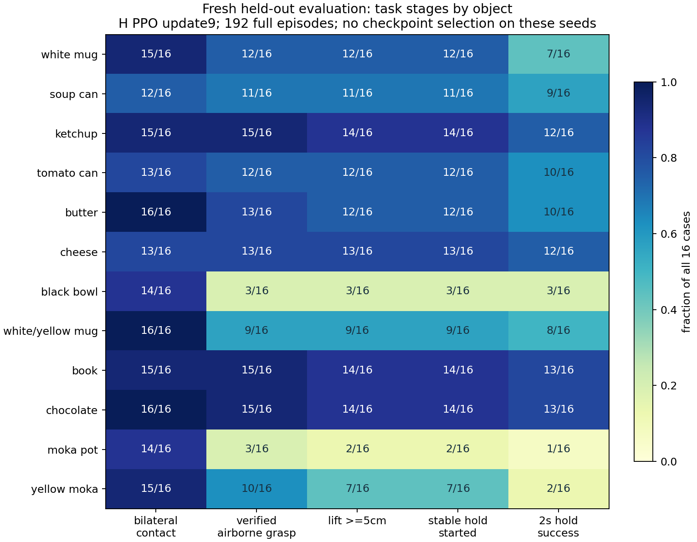
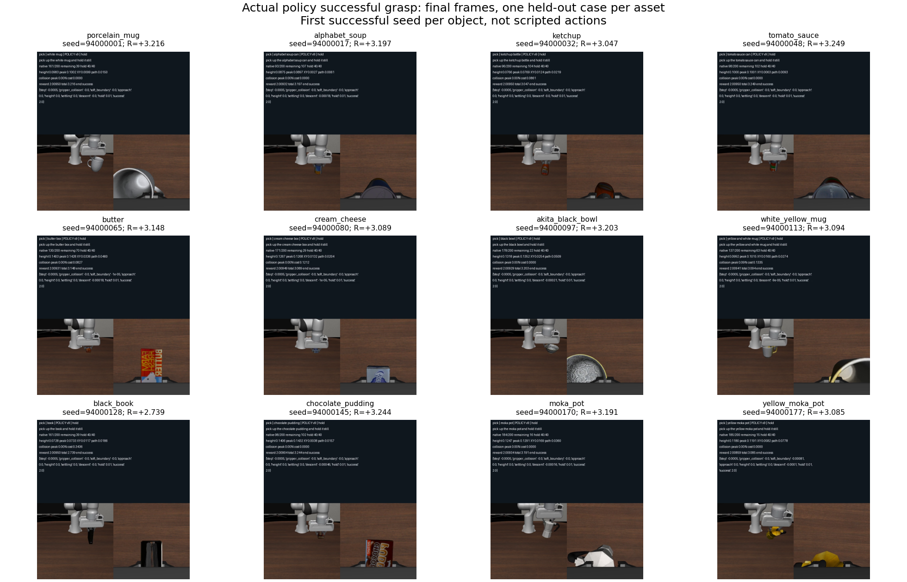
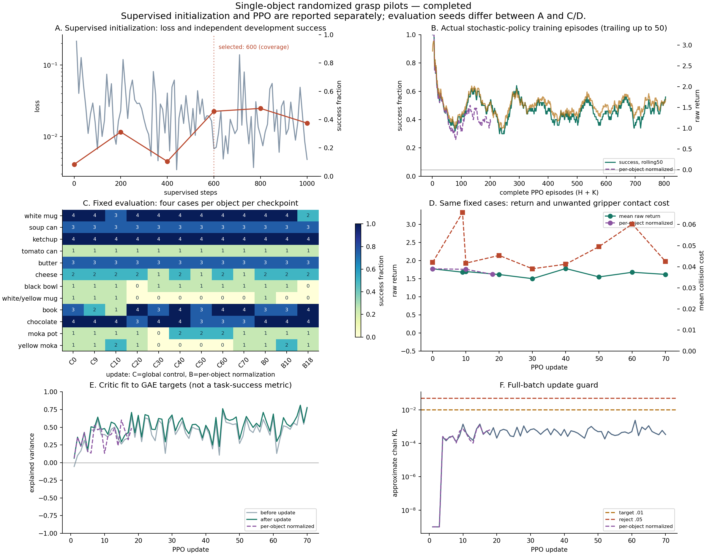

# 随机单物体抓取 v5：实验与诊断

状态：小规模训练已全部自行结束。主试训805个完整episode，真实成功374次（46.5%），578次总回报为正，平均+1.5237；另做了数个较短对照。数值与物理判定已通过验证，但尚未证明继续PPO能提高固定场景成功率，因此没有启动无人值守长训。最终独立192场景的验收结果见下文。

## 范围

仍以 `pi05_libero` 为冻结基座，迁移此前白杯 v4 update10 的 LoRA，再为新物体补充物理验证示范并做 PPO。每个场景只有一个目标，均匀随机选择资产，随机局部位置和 yaw；只有抓取，没有放置或扶正。

12 种资产对应：白杯 `porcelain_mug`；罐头 `alphabet_soup`；番茄酱瓶 `ketchup` 与番茄酱罐 `tomato_sauce`；黄油盒 `butter`；cheese 盒 `cream_cheese`；黑碗 `akita_black_bowl`；白黄杯 `white_yellow_mug`；书 `black_book`；chocolate `chocolate_pudding`；灰色与黄色摩卡壶 `moka_pot`、`yellow_moka_pot`。

本阶段沿用近目标抓取课程：物体局部 XY/yaw 随机，手臂经物理控制移到目标上方约 17cm 后开始策略动作，物体在桌上、夹爪张开；初始化动作不计入策略训练或10秒预算。书保留资产原本的立放姿态。本阶段尚未覆盖整张桌面任意位置搜索、多物体选择和全部初始摆放姿态。

## 修复与验证

### 夹爪碰撞

每个20Hz控制步内，对25个2ms MuJoCo物理子步统计非预期夹爪接触。目标与 finger/pad 的接触完全豁免；手掌撞目标、夹爪撞桌面/地面/外部几何体产生成本，夹爪内部几何体对不计。接触成本为：

`r_collision = -Σ[0.2 × dt × clip((F_bad - 0.5N) / 9.5N, 0, 1)]`

每控制步最多扣0.01，持续10秒最多扣2；接触解除即停止扣分，碰撞本身不终止任务。日志记录几何体名称、峰值法向力、穿透、冲量、持续时间、单步与累计成本。这里覆盖夹爪，尚未扩展为整个机械臂的碰撞成本。

36个物理控制中，12类目标全部重置有效；撞桌控制均扣分；张爪抬升控制均未取得真实抓取成功。另为每种资产找到真实可执行的成功抓取，12/12成功且总回报为正。这些脚本检查只验证物理与判定，**不计入模型成功率**。

### 薄盒的稳定判定

黄油和cheese真实抓起后，旧规则使用的瞬时求解器速度仍有0.015–0.04m/s，但连续2秒真实位置变化仅约0.01–0.02mm，导致保持计数反复清零。现在使用相邻20Hz控制步的真实位姿差分速度，并保留瞬时速度作诊断。抬升5cm、连续2秒、线速度≤1cm/s、角速度≤0.1rad/s、高度跨度≤5mm均保留。相同脚本动作修复后，两类均成功、回报约+3.22。

### 并行与重置

现有8个独立MuJoCo环境已并行。将训练重置从逐个等待改为批量发出、批量接收；脚本初始化期间跳过相机渲染，开始策略前恢复并刷新。白杯、黄油、摩卡壶对照证明初始图像、机器人state、完整物理状态及后续10步奖励完全一致。另做24次、覆盖12类的重复重置，状态与图像复现通过；关闭时解除碰撞监视回调引用，及时释放环境。

冻结视觉语言前缀缓存的配对PPO检查：同一批真实采样数据、相同权重、优化器与随机数种子，原版49.60秒，缓存版17.43秒，梯度更新阶段约2.85倍加速。全部可训练参数、Adam状态、价值预测的最大差异均为0；采样概率重算误差为0。每次更新仅缓存本批32个原始8行组，复用128次，更新结束即释放；动作专家与critic继续按当前参数重新计算。

## 当前奖励函数

所有正向进度只支付新纪录，反复抓起/放下不会重复获得同一份进度奖励。

| 分量 | 规则/最大金额 |
|---|---|
| 接近 | 夹爪完整 finger/pad 与目标碰撞几何体的最近表面距离改善，最多+0.10 |
| 双侧接触 | 连续3个控制步的左右侧接触，各侧法向力≥0.02N，一次+0.10；桌面接触可获进度但不算抬起 |
| 抬升 | 仅真实离桌抓持计分，碰撞底面离桌2mm至10cm线性增加，最多+0.50，超过10cm饱和 |
| 降速稳定 | 已抓住且离桌≥5cm、XY偏移<10cm，按线速度/角速度改善，最多+0.20 |
| 保持 | 连续稳定保持向40步推进，最多+0.40；中断重计时，不重复支付旧进度 |
| 成功 | 真抓持离桌≥5cm、连续40步满足稳定条件，+2并结束 |
| 时间 | 每原生步−0.0005，200步合计−0.10 |
| 超时 | 200步真正任务截止，另−0.30，终止且不bootstrap |
| 局部偏移 | 3cm内免费，3–10cm按平方渐增，最多−0.10/秒；返回停止成本，不直接结束 |
| 下降 | 已赚到抬升奖励后，物体累计下降超过全episode一次1mm容差的部分按−2/米；手臂下降接近目标不因此被扣 |
| 严重失败 | 目标偏移≥20cm或掉桌10cm等，−2并硬终止 |
| 夹爪碰撞 | 上述物理子步积分，正常finger/pad抓目标豁免，最多−0.20/秒 |

正奖励理论上限+3.30，减去时间和其他实际成本。超时失败仍可为负；接近、抬升和真实成功都可产生正回报。不能通过把奖励整体加常数来证明模型学会。

手工配置的是奖励函数；价值函数V由critic拟合未来折扣回报。critic使用冻结VLM特征和19项训练专用任务状态（时间、保持、进度、离桌高度、偏移、接触、相对漂移、速度、下降容差等）；actor仍只看图像、机器人状态与指令，未获得目标坐标/判定真值输入。

主要PPO参数：8环境×32 chunks，执行8步/预测10步，Flow-SDE噪声0.5，LoRA rank/alpha16，actor LR5e−6、critic LR1e−4；前三轮critic-only，actor随后10轮预热；minibatch64、2epochs、PPO/value clip0.2，gamma每原生步0.998、GAE λ每chunk0.95，actor/critic分别裁剪梯度到1，全批KL目标0.01/拒绝阈值0.05。采样边界保留未完成环境；评估用独立池；重启明确记录丢弃的未完成环境。

## 已完成实验

- 原白杯权重直接扩展：A对照40个RL episode仅1个白杯成功，固定验证0/48。修复速度和重置后的D smoke为41个episode、1成功，验证2/48。只迁移白杯能力不足。
- 每类6条物理成功示范，共72条、74次尝试；监督初始化与RL分别统计。200步dev验证15/48、400步5/48、600步22/48、800步23/48、1000步18/48。后期更新有退化，保留检查点；按物体覆盖和成功数选600步。
- 600步初始化在另96条新场景验证58/96（60.4%），均值+1.8096，12类均有真实成功。此组作为扩展诊断，最终验收还使用新的保留种子。
- 从较弱200步初始化的F PPO对照：101个完整episode，18成功，76个回报为正，均值+0.8926，平均碰撞成本0.0522。固定验证10/48→8/48，不能据此认定PPO稳定改善。
- 补充32条摩卡壶示范，采用较低监督LR和摩卡壶加权采样；验证未稳定超越600步初始化，未替换主试训起点。
- 主试训H+K已完成：H99次 + K新增706次 = 805次，70轮更新；374成功、578正回报，平均+1.5237。所有成功均逐轨迹核对连续40步真实抓持，成功回报均为正。H→K恢复了权重、Adam、随机数、采样计数，并明确丢弃8个没有序列化的未完结环境。
- 连续更新的采样logprob重算最大误差0，KL最大0.002413，无拒绝epoch。critic对当前批GAE目标的解释方差最终0.779，但固定验证28/48→26/48，说明critic拟合改善不能证明策略学会更多。
- 固定验证每类只有4条，后期白黄杯、黄色摩卡壶出现遗忘。update40总成功28/48，但只覆盖10类；没有用总体均值掩盖类别退化。按“12类覆盖优先、再看成功数”在**已经更新过actor的PPO检查点**中保留H update9：27/48、12类都有成功、平均+1.6794。它不优于初始化的28/48，不能声称RL已带来净提升。
- 保持奖励势函数对照L：100次完整episode，40成功，最终26/48、12类覆盖。目标/截止时间不变，保持中断有即时回退信号，但未明显改善，未采纳为默认。
- 按物体归一化优势并均衡当前类别梯度的对照M：201次完整episode，83成功，最终25/48、10类覆盖；同样没有明确优势，未采纳为默认。
- 全部PPO试验合计1288个完整episode（A40、D41、F101、H99、K706、L100、M201），不含监督训练、脚本示范和评估。主试训与对照分别统计，不能混作同一策略的成功率。

只凭监督loss下降、critic MSE降低、总reward为正均不足以判断成功。当前逐物体统计接触→真实离桌→抬升5cm→保持→终局成功，并逐完整轨迹核对成功条件与奖励分量。

## 仿真与扩展方式

当前是LIBERO-PRO、robosuite 1.5.2、MuJoCo 3.3.0、PyTorch 2.8.0，EGL渲染，8个独立进程环境批量策略推理。GPU为RTX PRO 5000 72GB Blackwell，本次仅使用6/7。

Isaac Lab中的多桌是环境克隆与并行仿真的展示方式；当前代码在MuJoCo中多摆桌子不会自动获得相同并行能力。官方资料：[Isaac Lab场景克隆](https://isaac-sim.github.io/IsaacLab/main/source/how-to/cloning.html)、[robosuite说明](https://robosuite.ai/assets/whitepaper.pdf)。

F实测每轮约81.9秒：模型推理16.5秒，物理推进4.0秒，重置10.0秒，梯度更新约50秒。当前瓶颈主要在模型计算，冻结前缀复用已针对该部分加速。迁移仿真需要重验资产、控制器、动作/观测与接触判定，本次先完成现有框架的学习验证。

## 独立最终验收

在选择H update9后，使用完全未参与选权重的94000000起始新种子，每类16次，共192个完整episode；全部有效重置、无替换失败样本。策略实际执行，非脚本代替、非回放成功演示。100/192成功（52.1%），平均总回报+1.5598，122次正总回报；12类均有成功。100次成功的总回报全部为正，范围+2.4922至+3.2491。16次/类的样本仍较少，不能将该比例看成精确的泛化成功率。

| 物体 | 成功/16 | 平均回报 | 平均非预期夹爪碰撞成本 |
|---|---:|---:|---:|
| 白杯 | 7/16 | +1.2591 | 0.2755 |
| 罐头 | 9/16 | +1.8038 | 0.0000 |
| 番茄酱瓶 | 12/16 | +2.3442 | 0.1068 |
| 番茄酱罐 | 10/16 | +2.0091 | 0.0000 |
| 黄油盒 | 10/16 | +2.0284 | 0.0377 |
| cheese | 12/16 | +2.3787 | 0.0318 |
| 黑碗 | 3/16 | +0.4211 | 0.0024 |
| 白黄杯 | 8/16 | +1.4742 | 0.0820 |
| book | 13/16 | +2.3214 | 0.2765 |
| chocolate | 13/16 | +2.6257 | 0.0097 |
| 灰摩卡壶 | 1/16 | -0.2226 | 0.0710 |
| 黄摩卡壶 | 2/16 | +0.2740 | 0.0793 |

92次失败全部为200步截止。按实际到达的最远阶段分解：18次从未出现双侧接触；43次接触过但没有形成经验证的离桌抓持；8次真抓持但未到5cm；23次进入稳定保持但未完成2秒。后23次中20次出现保持中断，只有5次首次进入保持已晚于第160步（两类可重叠）。因此优先问题是**接触如何变成可靠抓持，其次是抓起后的稳定保持**，不能把失败都归结为10秒太短。保留原任务时限，也不让策略去做后续无关任务。

最终逐192条轨迹核对：奖励分量和总回报一致；每个控制步确有25个物理子步的碰撞统计；正常目标手指接触豁免；全部成功末40步均真抓住、离桌≥5cm、XY<10cm、速度和高度跨度合格；所有动作版本均为update9。去掉critic专用状态后，actor动作最大差异0。审计详情在 `final-evaluation-proof.json`、`actor-input-contract.json`；汇总在 `results.json`。

平均碰撞成本0.0811。白杯和书仍有明显非预期接触，因此碰撞罚分是已生效的训练反馈，不代表碰撞问题已解决。22次失败也有正回报，这是部分进度奖励，不能计作成功。灰摩卡壶平均回报仍为负，说明该类别失败多，不能通过给所有奖励加常数掩盖。

每类按最小种子选择一条**实际模型成功视频**，不是按回报挑最好看的：路径与SHA见 `videos-manifest.json`，本地视频位于 `videos/`，服务器保留全部192条视频与原生轨迹。样例：[白杯](videos/porcelain_mug.mp4)、[黑碗](videos/akita_black_bowl.mp4)、[灰摩卡壶](videos/moka_pot.mp4)。

## 曲线诊断与是否扩大

最显著的异常是**critic越来越会预测当前训练分布，固定任务成功率却未提高，部分物体反而遗忘**。这里没有发现logprob不一致、actor零梯度、KL爆炸或接触成功漏判。接触率已经很高，困难物体主要损失在接触后形成可靠离桌抓持，以及抓起后稳定保持。带噪声的训练成功率与无采样噪声的固定评估必须分开看，不能用训练时正reward替代验证成功率。

训练中的每个物体均有真实成功，但黄色摩卡壶较弱。K续训706次：黑碗20/67成功、灰摩卡壶等具体阶段见audit-k，黄色摩卡壶10/63成功；这证明有成功轨迹可以学习，并不等于已经稳健掌握。记录逐物体接触、真实离桌、抬升5cm、首次进入保持的时刻、保持中断次数、最大保持步数、碰撞成本和终止原因，支持继续定位损失发生在哪一段。

技术条件已具备：实际actor更新、完整episode、奖励和接触审计、可恢复优化器、独立评估、可复现代码、缓存等价检查均通过；可以扩大独立测试。**效果条件尚未具备：本轮没有证据说明把当前配置直接放大成长训就能更好。** 不把805次里有成功、critic EV上升、总奖励为正解释成继续长训的充分依据。下一轮应继续围绕困难物体的抓持/保持与遗忘做有基线的实验，只有固定验证和类别覆盖同步改善才值得增加训练预算。

当前奖励默认仍为v5.1，保持奖励是历史最高进度，优势是全批归一化；两种对照作为可选配置保留，未因理论直觉就替换默认。夹爪碰撞已经有负反馈，但没有证明碰撞率持续下降，更没有宣称模型已无碰撞。

## 保存与复现

选定权重来自服务器 `runs/pick-v5-pilot800-20261106-h/checkpoints/final.pt`，PPO update9、累计99个完整episode；本地备份 `checkpoints/policy-u9.pt`。SHA256：`e5df8a0a026f67bfe7180b59b8bc921ef4c24db5fb7f068a6524c1354b80ecc8`。权重和原始视频不进入Git，来源、哈希与验收信息记录在manifest。

权重来源依次为pi05_libero冻结基座、已验证v4白杯LoRA、72条多物体示范的600步监督初始化、H的9轮PPO。模型现有能力包含监督初始化贡献，不能全归因于此次RL。

服务器预备入口 `run-pick-v5.sh` 使用独立validated配置、选定权重哈希校验和物理/优化器验证门禁。这里只准备入口，没有启动长训。`--resume` 恢复优化器/RNG，重启后的未完结模拟器明确丢弃；`--initial` 显式只迁移权重。重新训练前应确认所选GPU仍可用，当前配置仅指向物理GPU6的UUID。

本地验证：10项奖励/优势性质测试通过、全部Python文件可编译、启动脚本语法检查通过。物理控制与真实模型轨迹审计是主要依据；这些测试不替代策略成功率。

选定检查点与监督初始化相比，216个actor张量实际改变，最大绝对差6.888e−5；Adam计数72步。已核对与预备入口的任务/奖励/超参数及全部BDDL哈希一致，见 `selected-checkpoint-proof.json`。本地权重和12条视频哈希再次通过核验，见 `artifact-checks.json`。
