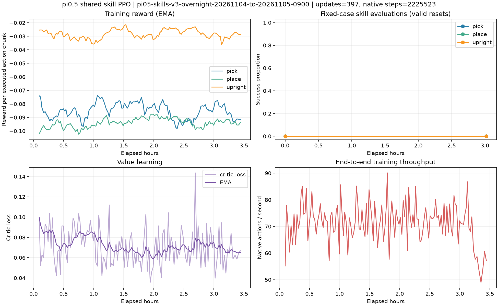

# 夜间强化训练最终报告（2026-11-05）

训练于北京时间 **08:51:54 正常结束**，监督器于08:52:05确认成功，早于09:00硬截止。**三个技能在固定评测上均无提升。** 奖励函数、模型结构、物理参数及PPO采样分组保持不变。

本次结果通知未能在约定09:00送达，最终汇报自动任务在14:19之后才触发；具体触发延迟原因未确认。服务器训练及结果文件按时完成。

| 技能 | 起点update257成功/有效 | 最终update807成功/有效 | 尝试 | 初始化失败 |
|---|---:|---:|---:|---:|
| 抓取 | 0/24 | 0/24 | 24 | 0 |
| 放置 | 0/21 | 0/21 | 24 | 3 |
| 扶正 | 0/24 | 0/24 | 24 | 0 |

起点与最终的72条固定案例元数据（ID、对象、场景及种子）逐项相同，结果返回顺序有差异。最终共69个有效初态、72次尝试；放置3次初始化失败单独报告。成功率口径是本项目自定义局部技能，不能当作原版LIBERO榜单。

## 训练与数值核验

- 从第257次更新及1,372,917原生动作步恢复；新增550次更新、3,349,352步；累计807次更新、4,722,269步。
- 未重新进入warmup；完整恢复权重、优化器和RNG；224份optimizer状态的step均为807。
- 服务器零重启，监督器attempt=0；没有继续启动任何新训练。
- 3h/6h/9h/12h checkpoint分别于22:24:26、01:24:19、04:23:21、07:23:20保存，各阶段固定评测均为零成功。
- 全550轮logprob重算最大误差为0；最大近似KL为0.00097121；梯度范数始终非零。
- 最终可训练参数相对起点最大变化0.00464120。权重确有更新，但未转化为技能成功。
- 自然完成训练轨迹22,407条，均无成功；训练初始化失败尝试1,778次；截止时24条活动轨迹按预算截断。
- 没有改动或终止liuyang及其他用户任务。

## 模型文件

- [最终checkpoint：第807次更新](checkpoints/final.pt)
- [best checkpoint：仍为第257次更新](checkpoints/best.pt)
- best保留最早达到最高固定评测分数的模型。所有评测分数均为0，因此best不代表学到了更好技能。
- 两个文件均已下载，SHA-256与服务器一致；包含LoRA、critic、optimizer、RNG及配置，需与记录的pi05_libero基础模型组合使用。
- [checkpoint路径、哈希和optimizer状态](final-checkpoint-manifest.json)

服务器目录：`/data/wangyihan/getscore-rl-skills/runs/pi05-skills-v3-overnight-20261104-to-20261105-0900/`。其下`checkpoints/final.pt`和`checkpoints/best.pt`为完整保留来源。

## 曲线与代表视频

- [抓取最终评测视频](videos/eval-final-actor0-pick.mp4)
- [放置最终评测视频](videos/eval-final-actor0-place.mp4)
- [扶正最终评测视频](videos/eval-final-actor0-upright.mp4)
- 三个视频均通过首末帧解码检查。

## W&B 与交付记录

[W&B完整指标](https://forge.coreweave.com/wandb/jiguangbrt-university-of-dundee/rpent-pi05-skills/runs/overnight20261104u257)

服务器始终保存完整offline日志；本机SSH指标中继最后一次成功轮询在02:59:56，停在第562次更新。最终整理时从服务器原始metrics补传了563–807共245次更新，并补传9h、12h和final评测。云端API已确认最终更新807、累计4,722,269步及completed状态。中继不连续，不能声称整夜云端监控无中断。

服务器自动最终报告提交：`d156063`。本机及服务器的本次交付报告另作范围内Git提交；完整数据见本目录RESULTS.json、evaluation-final.json、metrics.jsonl和events.jsonl。两个自动检查将在交付时暂停。

[机器可读最终汇总](FINAL_SUMMARY.json) · [最终逐例评测](evaluation-final.json) · [服务器完整报告](RESULTS.md)

## 2026-11-06 原始 W&B 离线日志上传

已确认本机已有有效W&B登录，账号为`jiguangbrt`，使用本机现有凭据上传，不在服务器或Git保存token。服务器原始offline run已只读拉取至本机缓存，原始记录流SHA-256与服务器一致。

[原始训练记录（包含视频）](https://forge.coreweave.com/wandb/jiguangbrt-university-of-dundee/rpent-pi05-skills/runs/suiipg6k)

云端核验：状态finished；550次训练更新（258–807）全部存在，最终累计4,722,269原生步；219个媒体文件全部存在、无缺失。该run ID为`suiipg6k`，是服务器原始W&B run；此前的`overnight20261104u257`指标中继run保留。两者对应同一训练实验。

[上传核验记录](wandb-original-upload-20261106.json)
